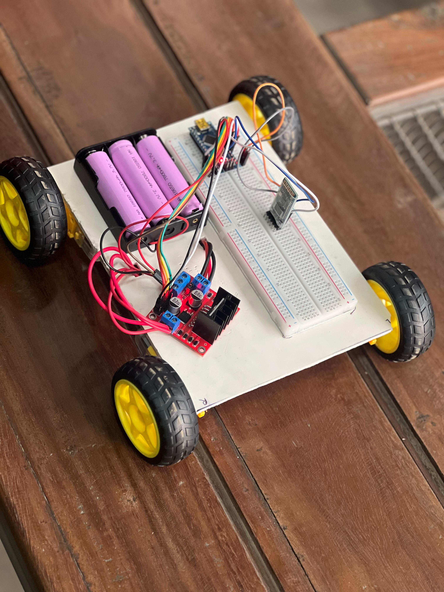
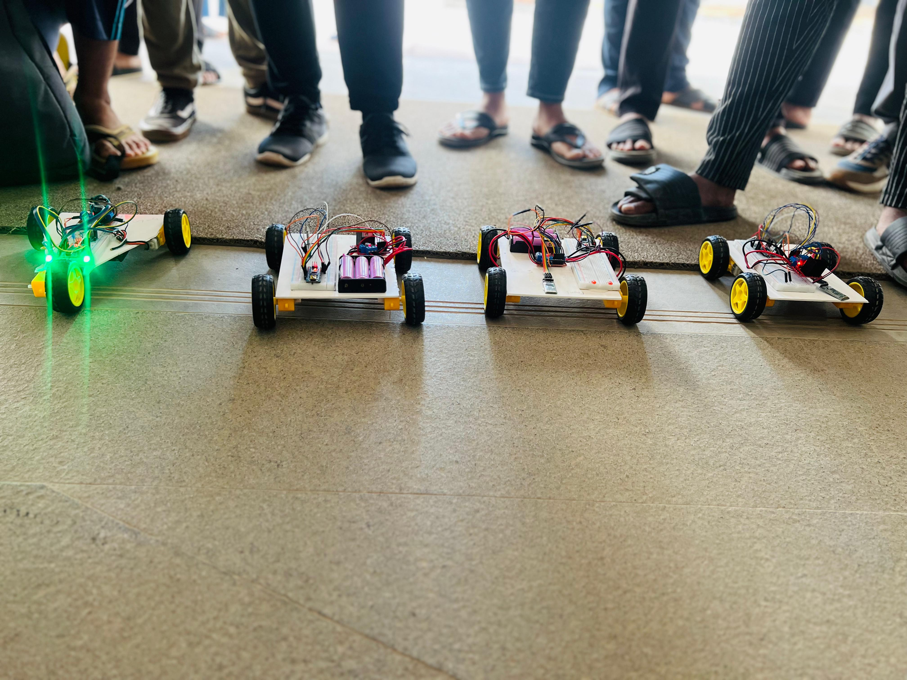
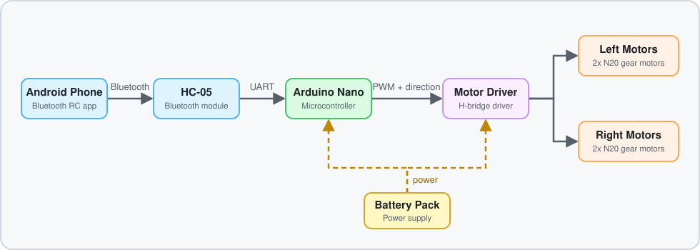
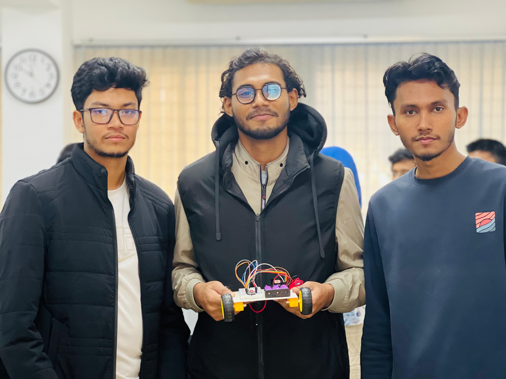
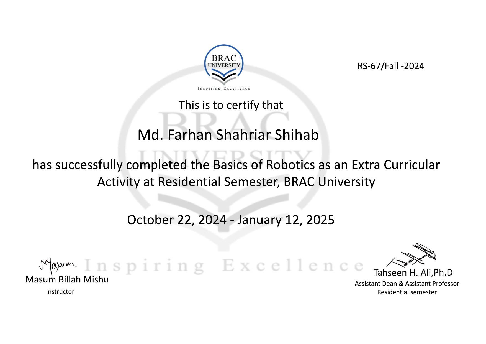

# Bluetooth RC Car

A smartphone-controlled 4-wheel RC car built with an Arduino Nano, an HC-05 Bluetooth module and N20 gear motors. Developed as a **group project** during the **Basics of Robotics** extra-curricular course at the Residential Semester, **BRAC University** (October 22, 2024 - January 12, 2025).

  

---

## Overview

About 30 students took part in the course. Working in groups, we designed and assembled RC cars from scratch. The project gave us hands-on experience with component selection, circuit wiring, microcontroller programming, wireless communication and motor control.

The car was disassembled after the course. This repository documents the build and includes the control firmware for the same hardware.

## Achievement

### 🏆 1st Place - RC Car Race

Our team's car secured **1st place** in an informal RC car race organized as part of the Basics of Robotics activity at the BRAC University Residential Semester.

The race was held among the course participants (about 30 students, competing in groups) as a friendly hands-on activity, rather than an official competitive robotics event.

  

## Features

- Wireless control from an Android phone over Bluetooth
- Forward, backward, left and right movement with differential steering
- Four-wheel drive using N20 gear motors
- 10-level PWM speed control
- Simple single-character command protocol, compatible with common Bluetooth RC apps

## Hardware

| Component | Qty | Role |
|---|---:|---|
| Arduino Nano | 1 | Main controller |
| HC-05 Bluetooth Module | 1 | Wireless communication |
| L298N Motor Driver | 1 | H-bridge driver for the motors |
| N20 DC Gear Motor | 4 | Drive wheels |
| Battery pack | 1 | Power supply |
| Chassis and wheels | 1 set | Body |

## System Design

  

The two motors on each side are wired in parallel and driven as one channel, which gives differential (tank-style) steering.

## Wiring

| Arduino Nano | Connected to |
|---|---|
| D2 | HC-05 TX |
| D3 | HC-05 RX (through a voltage divider) |
| D5 (PWM) | Driver ENA |
| D6 | Driver IN1 |
| D7 | Driver IN2 |
| D8 | Driver IN3 |
| D9 | Driver IN4 |
| D10 (PWM) | Driver ENB |
| 5V / GND | HC-05 VCC / GND |

## Control Protocol

Commands are single ASCII characters sent over Bluetooth at 9600 baud.

| Command | Action |
|---|---|
| `F` | Forward |
| `B` | Backward |
| `L` | Turn left |
| `R` | Turn right |
| `S` | Stop |
| `0` - `9` | Set speed (0 = slowest, 9 = fastest) |

## Getting Started

1. Wire the components as shown above.
2. Open [`rc_car/rc_car.ino`](rc_car.ino) in the Arduino IDE.
3. Select **Arduino Nano** as the board, then upload. If you get upload errors, disconnect the HC-05 RX/TX wires during upload.
4. Pair your phone with the HC-05 (default PIN `1234` or `0000`).
5. Open any Bluetooth RC car app, connect to the HC-05 and drive.

## Key Learnings

- Arduino-based embedded development
- DC motor control with an H-bridge driver and PWM
- UART communication over Bluetooth
- Power distribution and wiring for motors and logic
- Hardware troubleshooting and teamwork under a deadline

## Possible Improvements

- Add wheel encoders for speed feedback and straight-line driving
- Add an ultrasonic sensor for obstacle avoidance
- Improve battery management and voltage regulation
- Upgrade to an ESP32 for Wi-Fi/BLE control

## Team

Built by our team during the Basics of Robotics course:

- Md Farhan Shahriar Shihab ([@iamfarhan99](https://github.com/iamfarhan99))
- Ashraful Islam Shuvo
- Mehedi Hasan Sabbir

  

## Acknowledgements

- **Masum Billah Mishu**, Instructor, Basics of Robotics
- **BRAC University Residential Semester**, for organizing the course and the race

## Note on the Code

The original firmware was not preserved after the car was dismantled. The code in this repository is a reconstruction written for the same hardware.

## Certificate

Certificate of completion, Basics of Robotics, BRAC University Residential Semester.

  

## License

Released under the [MIT License](LICENSE).
